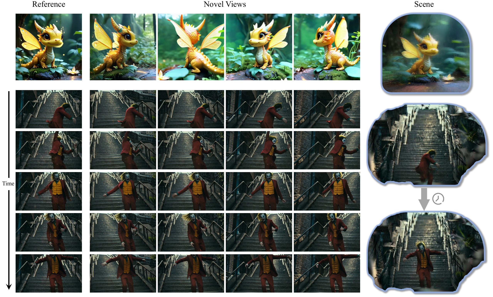

## ___***UniView: Large-Baseline View Synthesis via Video Diffusion Models***___
<div align="center">

 <a href='https://github.com/PKU-YuanGroup/UniView'></a> &nbsp;
 <a href='https://huggingface.co/Drexubery/UniView'></a> &nbsp;

</div>

🤗 If you find UniView useful, **please help ⭐ this repo**, which is important to Open-Source projects. Thanks!

## 🔆 Introduction

UniView can generate high-fidelity novel views from <strong>casually captured monocular video</strong> with precise pose control. UniView's novel view synthesis capability extends to <strong>Dynamic Scene Reconstruction</strong>. It combines Diffusion-based Novel View Synthesis and 4DGS for 4D reconstruction. 

<div align="center">
  
</div>


## ⚙️ Setup

### 0. GPU memory requirement

We recommend a GPU with **VRAM ≥ 80GB** for full pipeline of 4D reconstruction.

### 1. Clone UniView

```bash
git clone -b recon https://github.com/PKU-YuanGroup/UniView.git
cd UniView
```

### 2. Setup environment

```bash
conda create -n uniview-recon python=3.10 -y
conda activate uniview-recon
pip install torch==2.4.0+cu121 torchvision==0.19.0+cu121 --index-url https://download.pytorch.org/whl/cu121
pip install -r requirements.txt
pip install carvekit --no-deps
```

4D reconstruction is based on [MoSca](https://github.com/JiahuiLei/MoSca). Please follow the instructions to install the dependencies. 

```bash
pip install pyg_lib torch_scatter torch_geometric torch_sparse torch_cluster torch_spline_conv -f https://data.pyg.org/whl/torch-2.4.0+cu121.html
pip install --no-build-isolation extern/MoSca/lib_render/simple-knn
pip install --no-build-isolation extern/MoSca/lib_render/diff-gaussian-rasterization-alphadep-add3
pip install --no-build-isolation extern/MoSca/lib_render/diff-gaussian-rasterization-alphadep
pip install --no-build-isolation extern/MoSca/lib_render/gof-diff-gaussian-rasterization
pip install pytorch3d==0.7.8+pt2.4.0cu121 --extra-index-url https://miropsota.github.io/torch_packages_builder 
```

### 3. Download pretrained models

By default, UniView loads weights from `./checkpoints/` (see `checkpoints/README.md`).

#### (recommended): download to local `./checkpoints/`

```bash
bash checkpoints/download_hf.sh
```

This downloads: UniView transformer, Wan2.1-VACE, BLIP2, STream3R, MoGe, SAM2, TracerB7, Video-Depth-Anything, ROSE, MoSca and optional LoRA (see `checkpoints/README.md`).

## 💫 Inference

Run from the **repo root** (`UniView/`).

### 1. Command line

```bash
bash run_infer.sh
```

The output is saved in a directory with the **same name as the input** under the `output` folder, with the reconstructed scene stored in the `logs` subdirectory. It will take tens of minutes to complete the reconstruction.

## 📢 Limitations

Our model excels at handling videos with well-defined objects and clear motion, as demonstrated in the demo videos. However, since it is built upon a pretrained video diffusion model, it may struggle with complex cases that go beyond the generation capabilities of the base model.

## 🤗 Related Works

Including but not limited to: [CogVideo-Fun](https://github.com/aigc-apps/CogVideoX-Fun), [ViewCrafter](https://github.com/Drexubery/ViewCrafter), [DepthCrafter](https://github.com/Tencent/DepthCrafter), [GCD](https://gcd.cs.columbia.edu/), [NVS-Solver](https://github.com/ZHU-Zhiyu/NVS_Solver), [DimensionX](https://github.com/wenqsun/DimensionX), [ReCapture](https://generative-video-camera-controls.github.io/), [TrajAttention](https://xizaoqu.github.io/trajattn/), [GS-DiT](https://wkbian.github.io/Projects/GS-DiT/), [DaS](https://igl-hkust.github.io/das/), [RecamMaster](https://github.com/KwaiVGI/ReCamMaster), [GEN3C](https://research.nvidia.com/labs/toronto-ai/GEN3C/), [CAT4D](https://cat-4d.github.io/)...

## 📜 Citation

If you find this work helpful, please consider citing:

```BibTeX
@misc{zhou2026uniworldviewlargebaselineviewsynthesis,
      title={UniWorld-View: Large-Baseline View Synthesis via Video Diffusion Models}, 
      author={Haiyang Zhou and Wangbo Yu and Chaoran Feng and Xunyu Zhou and Yonghong Tian and Li Yuan},
      year={2026},
      eprint={2608.04701},
      archivePrefix={arXiv},
      primaryClass={cs.CV},
      url={https://arxiv.org/abs/2608.04701}, 
}
```

## License

This project is licensed under Apache-2.0. See `LICENSE`.
